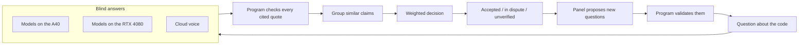

# SuperMoE

**A multi-model review panel that looks for real defects in a codebase, and is measured on whether it finds them.**

> **In development · First validation results published**
>
> Reviewed 19 November 2026. Two experiments have finished: a verification battery (18 November, n = 45 per arm) and an open-audit battery with planted defects (19 November, 28 seeded rounds and 8 controls). Every number below was measured on the date and sample size stated.

[How it works](docs/how-it-works.md) · [What we learned](docs/what-we-learned.md) · [Validation and results](docs/validation.md) · [Disclosure policy](docs/public-disclosure-policy.md) · [Ariamir showcase](https://github.com/remixazkA/ariamir-showcase)

## What it is

SuperMoE is a review panel. Several open-weight language models, running on two GPUs, answer the same question about a codebase **blind**, without seeing each other's answers. A program then checks every quote they cite against the real files. The answers are grouped, a weighted decision is taken, and the panel proposes new questions of its own to settle whatever remains in dispute.

It is used on [Ariamir](https://github.com/remixazkA/ariamir-showcase), a local-first AI workspace, but the idea is general: a panel that reviews code and is itself reviewed.

## Why it exists

A single model reviewing code can be confidently wrong, and several models agreeing is not proof. The project started from one question: does a panel of many voices find **more real errors, with fewer false ones**, than one or three reviewers, at a cost that justifies it? "The panel accepted N conclusions" does not answer that, because an accepted conclusion is not necessarily a true one. SuperMoE is therefore built to be measured against an oracle that no model controls.

## How it works at a glance

Details are in [How it works](docs/how-it-works.md).

## Hardware

| Card | Memory | Role |
|---|---|---|
| NVIDIA A40 | 48 GB | Larger models, one lane |
| NVIDIA GeForce RTX 4080 | 16 GB | Smaller models, second lane |

Models take turns in the two lanes. A full round with about a dozen voices takes roughly 12 minutes. Measured on 18 November 2026 (first round of that day), single-model answer times were between about 1 and 2 minutes, for example a Qwen 27B model on the A40 at about 63 s and a Gemma model on the 4080 at about 115 s.

## Latest results

**Open audits with planted defects (19 November 2026).** Each round shows real code and asks, with no hint, whether it has a defect. In 28 rounds one line had been changed on purpose; in 8 control rounds nothing had been touched.

| Arm | Seeded errors found (of 28) | False alarms on controls (of 8) | GPU-s per round |
|---|---|---|---|
| A: one reviewer | 20 | **0** | **56** |
| B-vote: three voices, vote on verdicts | **24** | 1 (+1 dubious) | 71 |
| C-vote: full panel, vote on verdicts | 25 | 5 | 502 |
| B and C: same voices, accepted-group rule | 13 and 19 | 1 and 3 | 71 and 502 |

Three voices that vote find more planted defects than one reviewer, at a small extra cost. The full panel finds one more, but raises five times as many false alarms at seven times the GPU time. The accepted-group rule requires two experts to agree within a group. With three voices, that rule finds 13 planted defects where voting finds 24.

**Verifying a single claim (18 November 2026).** Here one reviewer was already at the ceiling: 43 of 45 correct with the registered scoring rule (45 of 45 after a manual check of the scoring), at 23 GPU-s per question, against 32 correct and 8 wrong for the full panel at 420 GPU-s.

Method, all arms, the remaining charts and the limits are in [Validation and results](docs/validation.md). The data behind every chart is in [docs/data](docs/data).

## What we have measured

| Finding | Result | Sample |
|---|---|---|
| Open audits, planted defects found | One reviewer 20, three voting voices 24, full panel voting 25 | 28 seeded rounds, 19 Nov 2026 |
| Open audits, false alarms on untouched code | One reviewer 0, three voting voices 1 (+1 dubious), full panel voting 5 | 8 control rounds, 19 Nov 2026 |
| Verifying a claim: one reviewer vs. full panel | 43 vs. 32 correct, 2 vs. 8 wrong, 23 vs. 420 GPU-s per question | 45 per arm, 18 Nov 2026 |
| Rule-based grouping vs. a model doing the grouping, in verification | 32 vs. 31 correct, 3 vs. 4 wrong, 51 vs. 67 GPU-s | 45 per arm, 18 Nov 2026 |
| Absence claims ("X does not exist") accepted by the panel | 18 were false | 43 accepted, decidable claims |
| Precision of accepted absence claims after a whole-codebase check | 58% (25 of 43) to 73% (11 of the 15 still accepted) | 43 accepted, decidable claims |
| Simple rule-based grouping vs. a model doing the grouping | Reproduces 83% of the model's accepted groups | 83 rounds |
| Previously unknown real defects found in code nobody had seeded | 4 (details private) | the 19 Nov battery |

Interpretation and limits are in [What we learned](docs/what-we-learned.md).

## Models in testing

The roster is being revised. Candidates are measured on the same planted-defect battery before anything changes. **They are in testing; no results are reported for them yet.**

**Leaving the panel**

- **gpt-oss:** removed (19 November 2026).
- **Granite and Gemma:** under review. Nemotron-3.5-Bolt-E4B and Qwen3.6-35B-A3B are being measured as their replacements on the RTX 4080.

**In testing**

| Model | Architecture | Speculative decoding to test | GPU |
|---|---|---|---|
| Nemotron-3.5-Bolt-E4B (NVIDIA) | Dense, 8B (4B effective) | Official DFlash draft model | RTX 4080 |
| Qwen3.6-35B-A3B | MoE, 35B total, 3B active; hybrid attention | DFlash draft model; an MTP build is optional | RTX 4080, with some experts in system RAM |
| Flint | MoE, about 40B total, 2.5B active | DFlash2 draft model | A40 |
| Ornith-1.5-35B-A3B | MoE, about 35B total, 3B active; hybrid attention | MTP head built into the model file | A40 |
| North-Mini-Code 1.0 (Cohere) | MoE, 30B total, about 3B active | None available; n-gram lookup only | A40 |
| Mistral Small 4 (119B) | MoE, 119B total, 6.5B active | None usable yet; n-gram lookup only | A40 alone, or split across both GPUs |

Mistral Small 4 would be a new local voice; the panel's Mistral voice today runs in the cloud.

**How they are measured.** MTP (multi-token prediction) and DFlash speed up generation by guessing several tokens ahead. MTP uses an extra head inside the model; DFlash uses a small separate draft model. Either should change speed, not quality. So each candidate runs first without speculative decoding, then with it. Sampling and speculative decoding are never changed in the same run.

- **Quality:** seeded errors found and false alarms on controls.
- **Speed:** tokens per second and GPU-seconds.

A candidate counts most if it lowers the panel's false alarms without losing planted defects.

## Status

- **Working in development:** the blind panel, citation checking, rule-based grouping, the decision step and self-generated follow-up questions, running continuously on the two-GPU machine.
- **Adopted (19 November 2026), for verifying claims:**
  - one reviewer, which escalates to a vote of three voices only when it is in doubt;
  - a vote on each voice's verdict in place of the accepted-group rule;
  - rule-based grouping by default.
- **Proposed, not adopted:** for open audits, a three-voice vote, with the flagged claims then checked by the single reviewer. A second battery with new planted defects comes first.
- **In testing:** the candidate models above.

## Related

SuperMoE reviews [Ariamir](https://github.com/remixazkA/ariamir-showcase). This repository documents the panel only. It contains no code.
