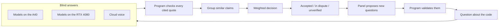

# SuperMoE

**A multi-model review panel that looks for real defects in a codebase, and is measured on whether it finds them.**

> **In development · Validation in progress**
>
> Reviewed 18 November 2026. Validation in progress; results will be published when the three repetitions finish. Every number below was measured on the date and sample size stated.

[How it works](docs/how-it-works.md) · [What we learned](docs/what-we-learned.md) · [Validation method](docs/validation.md) · [Disclosure policy](docs/public-disclosure-policy.md) · [Ariamir showcase](https://github.com/remixazkA/ariamir-showcase)

## What it is

SuperMoE is a review panel. Several open-weight language models, running on two GPUs, answer the same question about a codebase **blind**, without seeing each other's answers. A program then checks every quote they cite against the real files. The answers are grouped, a weighted decision is taken, and the panel proposes new questions of its own to settle whatever remains in dispute.

It is used on Ariamir, a local-first AI workspace, but the idea is general: a panel that reviews code and is itself reviewed.

## Why it exists

A single model reviewing code can be confidently wrong, and several models agreeing is not proof. The project started from one question: does a panel of many voices find **more real errors, with fewer false ones**, than one or three reviewers, at a cost that justifies it? "The panel accepted N conclusions" does not answer that, because an accepted conclusion is not necessarily a true one. SuperMoE is therefore built to be measured against an oracle that no model controls.

## How it works at a glance

Details are in [How it works](docs/how-it-works.md).

## Hardware

| Card | Memory | Role |
|---|---|---|
| NVIDIA A40 | 48 GB | Larger models, one lane |
| NVIDIA GeForce RTX 4080 | 16 GB | Smaller models, second lane |

Models take turns in the two lanes. A full round with about a dozen voices takes roughly 12 minutes. Measured on 18 November 2026 (first round of that day), single-model answer times were between about 1 and 2 minutes, for example a Qwen 27B model on the A40 at about 63 s and a Gemma model on the 4080 at about 115 s.

## What we have measured

| Finding | Result | Sample |
|---|---|---|
| Absence claims ("X does not exist") accepted by the panel | 18 were false | 43 accepted, decidable claims |
| Precision of accepted absence claims after a whole-codebase check | 58% (25 of 43) to 73% (11 of the 15 still accepted) | 43 accepted, decidable claims |
| Simple rule-based grouping vs. a model doing the grouping | Reproduces 83% of the model's accepted groups | 83 rounds |

Interpretation and limits are in [What we learned](docs/what-we-learned.md).

## Status

- **Working in development:** the blind panel, citation checking, grouping, weighted decision and self-generated follow-up questions, running continuously on the two-GPU machine.
- **In validation:** the 1 / 3 / 13 voice comparison on a seeded battery with a mechanical oracle. Validation in progress; results will be published when the three repetitions finish.
- **Not decided:** whether the full panel is kept as is, scaled adaptively, or slimmed down. That depends on the validation.

## Related

SuperMoE reviews [Ariamir](https://github.com/remixazkA/ariamir-showcase). This repository documents the panel only. It contains no code.
